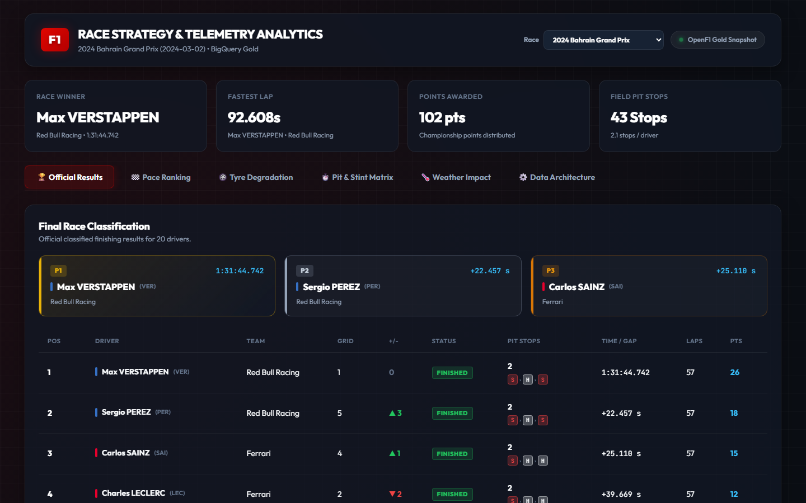
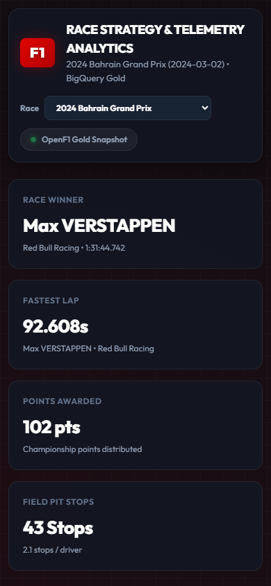
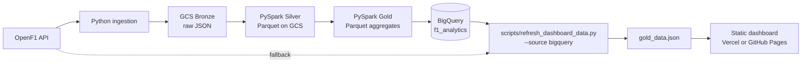

# F1 Race Analytics Pipeline

An OpenF1 data pipeline that ingests race sessions, transforms them with PySpark, loads Gold analytics tables into BigQuery, and serves a static race dashboard.

[](https://github.com/Neelanshdosi/f1-dashboard/actions/workflows/ci.yml)


## Live dashboard

**Dashboard URL:** TODO(owner): add the deployed Vercel or GitHub Pages URL.

The static dashboard presents race results, starting grid vs finishing position slope charts, pit stop & tyre stint timelines, pace rankings, tyre degradation curves, and weather observations.

<!-- Generated screenshots -->



<!-- Placeholder references for screenshots not yet generated -->
<!-- TODO(owner): generate docs/images/tyre_degradation.png -->
<!-- TODO(owner): generate docs/images/pit_strategy.png -->
<!-- TODO(owner): generate docs/images/race_selector.png -->

## What it answers

- How lap times vary with tyre compound and tyre age.
- How drivers compare across stints and pit stops.
- How race pace differs between drivers.
- What weather and track conditions were recorded during a session.

## Architecture



The static dashboard serves data directly from `gold_data.json` without requiring BigQuery access in the browser. The dashboard snapshot is rebuilt directly from BigQuery Gold tables using `python scripts/refresh_dashboard_data.py --source bigquery` (with partition-pruned queries on `session_key`). The default `--source api` mode serves as a local development fallback that fetches directly from OpenF1 and computes transforms via Spark, bypassing GCP. `vercel.json` points Vercel at the `dashboard/` directory; no deployed URL is recorded here yet.

## Data model

### Bronze — raw JSON on GCS

The ingestion config requests these OpenF1 endpoints and stores each endpoint under `gs://<bucket>/bronze/<endpoint>/season=<year>/session_key=<key>/`:

| Endpoint | Contents |
|---|---|
| `sessions` | Session metadata used to select race sessions |
| `drivers` | Driver identity and team metadata |
| `laps` | Lap, sector, speed, and pit-out-lap fields |
| `stints` | Tyre compound, stint number, and lap range |
| `pit` | Pit-lap and pit-stop duration data |
| `weather` | Timestamped weather and track conditions |
| `car_data` | Timestamped vehicle telemetry |

### Silver — Parquet on GCS

| Table | Contents |
|---|---|
| `dim_sessions` | Typed session and circuit metadata, including `session_key`, `meeting_key`, dates, location, and season |
| `dim_drivers` | Driver identifiers, names, acronym, team, colour, country, and headshot URL |
| `fct_laps` | Typed lap and sector fields, pit-out flag, plus `lap_time_seconds`; when stints are available, includes `stint_number`, `tyre_compound`, and calculated `tyre_life` |
| `fct_stints` | Driver/session stint number, lap range, compound, and starting tyre age |
| `fct_pit` | Driver/session pit lap, timestamp, pit, stop, and lane durations |
| `fct_weather` | Timestamped air/track temperature, humidity, pressure, wind, and rainfall fields |
| `fct_car_data` | Timestamped RPM, speed, gear, throttle, brake, and DRS fields |
| `fct_session_result` | Session classified outcomes, positions, points, duration, gaps, and DNF/DNS/DSQ flags |
| `fct_starting_grid` | Starting grid slots (`position`) and qualifying lap durations |

Silver files are written below `gs://<bucket>/silver/<table>/season=<year>/session_key=<key>/`. Malformed or out-of-bounds records failing quality rules are routed to `gs://<bucket>/silver/rejected_records/season=<year>/session_key=<key>/`.

### Gold — BigQuery `f1_analytics`

Aggregated tables are range partitioned on `session_key` using `RANGE_BUCKET(session_key, GENERATE_ARRAY(9000, 12000, 1))`. Clustering fields are listed per table. `dim_sessions` is stored unpartitioned for global session reference, and `pipeline_run_audit` tracks ingestion and transformation execution metrics.

| Table | Columns | Clustered by |
|---|---|---|
| `agg_driver_race_summary` | `session_key`, `meeting_key`, `driver_number`, `driver_name`, `name_acronym`, `team_name`, `team_colour`, `total_laps`, `fastest_lap_seconds`, `avg_lap_seconds`, `total_pit_stops`, `total_pit_duration`, `starting_compound`, `max_stint_length` | `driver_number`, `team_name` |
| `agg_tyre_degradation` | `session_key`, `driver_number`, `driver_name`, `team_name`, `stint_number`, `compound`, `tyre_age`, `lap_number`, `lap_time_seconds`, `stint_avg_lap_time`, `delta_to_stint_avg` | `compound`, `driver_number` |
| `agg_pit_strategy` | `session_key`, `driver_number`, `driver_name`, `team_name`, `stint_number`, `compound`, `lap_start`, `lap_end`, `stint_length`, `pit_lap`, `pit_duration`, `stop_duration` | `driver_number`, `compound` |
| `agg_weather_impact` | `session_key`, `date_utc`, `air_temperature`, `track_temperature`, `humidity`, `pressure`, `wind_speed`, `wind_direction`, `rainfall`, `field_avg_lap_time` | `session_key` |
| `agg_driver_telemetry` | `session_key`, `meeting_key`, `driver_number`, `driver_name`, `team_name`, `team_colour`, `max_speed`, `avg_speed`, `avg_throttle`, `full_throttle_pct`, `brake_pct`, `drs_open_pct` | `driver_number` |
| `agg_race_results` | `session_key`, `driver_number`, `driver_name`, `name_acronym`, `team_name`, `team_colour`, `grid_position`, `final_position`, `positions_gained`, `status`, `total_pit_stops`, `number_of_laps`, `points`, `duration_seconds`, `gap_to_leader_seconds`, `laps_down`, `grid_position_missing` | `driver_number`, `team_name` |
| `dim_sessions` | `session_key`, `meeting_key`, `session_name`, `date_start`, `circuit_key`, `country_name`, `year` | *(Unpartitioned dimension)* |
| `pipeline_run_audit` | `job_name`, `session_key`, `season`, `table_name`, `rows_in`, `rows_out`, `rows_rejected`, `started_at`, `duration_seconds`, `status` | *(Run audit log)* |

#### Race Results Status Rules
Driver status in `agg_race_results` is evaluated strictly in the following order:
1. `dsq == True` → `"DSQ"`
2. `dns == True` → `"DNS"`
3. `dnf == True` → `"DNF"`
4. `final_position is not null` → `"Finished"` (lapped finishers are classified as `"Finished"`, with `laps_down` populated)
5. Otherwise (including drivers with no session result row) → `"Unclassified"`

#### OpenF1 Starting Grid Endpoint Coverage & Resolution
The OpenF1 beta endpoint `/v1/starting_grid` keys grid data to the **Qualifying** session of a race weekend rather than the Race session. Direct queries with a Race `session_key` return HTTP 404 (`{"detail":"No results found."}`). The ingestion pipeline and dashboard refresh resolve the corresponding Qualifying session (`session_name == "Qualifying"`) via `/v1/sessions?meeting_key=<M>&session_name=Qualifying`, fetch the starting grid under that qualifying session key, and rewrite records to the race `session_key` while recording `grid_source_session_key`.

Measured on 2026-10-21 via `python scripts/probe_openf1.py`:

| Race Session Key | Qualifying Session Key | Year | Meeting Key | Session Name | HTTP Status | Starting Grid Rows |
|---|---|---|---|---|---|---:|
| `9472` | `9468` | 2024 | 1229 | Race | 200 | 20 |
| `9662` | `9658` | 2024 | 1252 | Race | 200 | 20 |
| `9693` | `9689` | 2025 | 1254 | Race | 200 | 20 |
| `9839` | `9835` | 2025 | 1276 | Race | 200 | 20 |
| `9947` | `9943` | 2025 | 1277 | Race | 200 | 20 |
| `9979` | `9975` | 2025 | 1261 | Race | 200 | 20 |
| `10014` | `10010` | 2025 | 1257 | Race | 200 | 20 |

> **Starting Grid Penalties Note**:
> OpenF1 grid positions may differ from qualifying order; whether they include penalties was observed on one race and is not otherwise verified.

> **Pit Stop Detection Rule Note**:
> Stops are counted when OpenF1 gives a stop time, or when the pit-lane duration is at least 18 s. The 18 s value was chosen from observed data and may misclassify very short or very long pit-lane passes.

> **Pace Ranking Note**:
> Driver pace ranking is ordered strictly by fastest lap time in the session, not official race finishing classification. Official finishing results and points are presented separately in the Race Results view.

## Data quality

The pipeline uses a **Quarantine Pattern** to validate incoming records against business rules and domain bounds defined in `config.yaml`, routing anomalies into a dedicated quarantine store rather than letting them corrupt downstream analytics or silently fail jobs:

1. **Validation & Quarantine**:
   - Incoming records are validated for non-null key constraints (`session_key`, `driver_number`, `lap_number`, `stint_number`, `date_utc`), valid timestamp parsing, and realistic physical bounds:
     - Lap times: `lap_time_min_seconds` (50.0s) to `lap_time_max_seconds` (300.0s).
     - Stints: `stint_lap_min` (>= 1) and `lap_end >= lap_start`.
     - Pit stops: `pit_duration_min_seconds` (5.0s) to `pit_duration_max_seconds` (300.0s).
     - Weather: `track_temp_min` (0.0°C) to `track_temp_max` (85.0°C); `air_temp_min` (0.0°C) to `air_temp_max` (60.0°C).
   - Valid records proceed down the standard Silver Parquet transformation path.
   - Faulty records are quarantined to `gs://${GCS_BUCKET}/silver/rejected_records/season=<season>/session_key=<session>/` with the following schema:
     - `source_table` (STRING): Name of the source entity (e.g., `fct_laps`).
     - `reject_reason` (STRING): Categorical reason for quarantine (e.g., `null_driver_number`, `lap_time_out_of_range`, `invalid_stint_laps`, `pit_duration_out_of_range`, `invalid_timestamp`).
     - `raw_record` (STRING): Full original record serialized as a JSON string for auditing and reprocessing.
     - `session_key` (INT): Session identifier.
     - `rejected_at` (TIMESTAMP): UTC timestamp when the record was rejected.

2. **Pipeline Run Audit**:
   - Both `bronze_to_silver` and `silver_to_gold` log execution metrics to BigQuery table `f1_analytics.pipeline_run_audit` (or append to a local JSON-lines file `pipeline_run_audit.jsonl` when running locally with `file://`):
     - `job_name` (STRING): `bronze_to_silver` or `silver_to_gold`.
     - `session_key` (INT64): Target session key.
     - `season` (INT64): Target championship season year.
     - `table_name` (STRING): Target table being processed.
     - `rows_in` (INT64): Count of records read into the transformation.
     - `rows_out` (INT64): Count of clean records output.
     - `rows_rejected` (INT64): Count of records quarantined.
     - `started_at` (TIMESTAMP): Run start time.
     - `duration_seconds` (FLOAT64): Step processing duration in seconds.
     - `status` (STRING): Execution status (`SUCCESS` or `FAILED`).

## Scale

Run `python scripts/dataset_stats.py` to count the static Gold dashboard records.

| Dataset | Rows |
|---|---:|
| `agg_driver_race_summary` | 120 |
| `agg_tyre_degradation` | 6,310 |
| `agg_pit_strategy` | 392 |
| `agg_weather_impact` | 962 |
| Races in dashboard data | 6 |

Bronze rows: TODO(owner): fill from GCS.  
Silver rows: TODO(owner): fill from GCS.

`max_sessions_per_season` and `car_data_row_cap` in `config.yaml` are development settings. The commented full-run example removes both caps and includes seasons 2023–2025. The Silver/Gold dashboard refresh contains five selected 2025 races in addition to the existing 2024 Bahrain race.

> **Note**: When `car_data_row_cap` is set, telemetry metrics are computed on a capped sample; set it to null for full-resolution metrics.

## BigQuery optimization

Run `python scripts/benchmark_bq.py` with BigQuery credentials to replace the placeholders below with dry-run byte estimates. The script creates unpartitioned comparison copies; it does not run or publish benchmark results automatically.

| Query | Unpartitioned bytes | Partitioned + clustered bytes | Reduction % |
|---|---:|---:|---:|
| Tyre degradation for one race | 104,590 | 104,590 | 0.0% |
| Pit strategy for one race and driver | 5,747 | 5,747 | 0.0% |
| Weather impact for one race | 12,560 | 12,560 | 0.0% |
| Driver summary for one team | 2,346 | 2,346 | 0.0% |

See [`docs/benchmark.md`](docs/benchmark.md) for the report file and [`sql/benchmark.sql`](sql/benchmark.sql) for the query definitions.

## Design decisions

### Keep raw JSON in Bronze

Bronze preserves source responses so transformations can be rerun after fixes.

### Use Hive-style GCS paths

Season and session keys in the object path make each session easy to locate and process independently.

### Use a dual token bucket

The ingestion client enforces both per-second and per-minute request limits to control bursts and total API traffic.

### Make ingestion idempotent

Existing objects are skipped by default; `--overwrite` requests a fresh download.

### Store Silver as Parquet

Parquet provides typed, columnar Silver files for Spark reads and reduces repeated parsing of raw JSON.

### Partition Gold by `session_key`

Race-level analysis queries filter on a session key. The configured range covers current session IDs while keeping the partition count below BigQuery's 10,000 limit.

### Serve the dashboard from static JSON

The dashboard is a static site and can be hosted without BigQuery credentials in the browser. Its charts use the generated JSON snapshot; the analytical tables are loaded separately into BigQuery.

## How to run

### Clone and install

```bash
git clone https://github.com/Neelanshdosi/f1-dashboard.git
cd f1-dashboard
python -m venv .venv
source .venv/bin/activate       # Windows: .venv\Scripts\activate
pip install -r requirements.txt
```

Copy `.env.example` to `.env` and set `GCP_PROJECT_ID`, `GCS_BUCKET`, and `DATAPROC_SA`. Authenticate with Google Cloud ADC or set `GOOGLE_APPLICATION_CREDENTIALS` for local cloud access.

### Ingest Bronze

```bash
# Local write or dry-run
python -m ingestion.ingest --local --session-key 9472
python -m ingestion.ingest --local --dry-run

# Write to the configured GCS bucket
python -m ingestion.ingest --session-key 9472
```

The ingestion command also accepts `--config`, `--season` (comma-separated years), `--overwrite`, and `--log-level`.

### Run Silver and Gold jobs

Both Spark jobs accept `--session-key`, `--season`, and `--base-uri` (default session 9472, season 2024, default base URI `gs://${GCS_BUCKET}`):

```bash
SPARK_LOCAL_MODE=1 python spark_jobs/bronze_to_silver.py --session-key 9472 --season 2024 --base-uri file:///path/to/lakehouse
SPARK_LOCAL_MODE=1 python spark_jobs/silver_to_gold.py --session-key 9472 --season 2024 --base-uri file:///path/to/lakehouse
```

`SPARK_LOCAL_MODE=1` selects the jobs' local single-worker Spark configuration. Without it, the jobs retain the Spark settings supplied by `spark-submit`. When `--base-uri` starts with `file://`, the jobs run locally without downloading blobs to the driver temp directory, and `silver_to_gold` skips the BigQuery upload step.

The jobs read and write `gs://` directly through the Cloud Storage connector available natively on Dataproc.

Dataproc Serverless submission form (replace the bracketed values):

```bash
gcloud dataproc batches submit pyspark spark_jobs/bronze_to_silver.py \
  --region=[region] --deps-bucket=[bucket] \
  -- --session-key=[session_key] --season=[season] --base-uri=gs://[bucket]
gcloud dataproc batches submit pyspark spark_jobs/silver_to_gold.py \
  --region=[region] --deps-bucket=[bucket] \
  -- --session-key=[session_key] --season=[season] --base-uri=gs://[bucket]
```

> **Note**: Dataproc execution: `TODO(owner): verify on Dataproc`.

### Refresh and inspect dashboard data

```bash
# Rebuild from BigQuery Gold tables (recommended in production):
python scripts/refresh_dashboard_data.py --source bigquery

# Rebuild directly from OpenF1 API via local Spark (fallback, bypasses GCP):
python scripts/refresh_dashboard_data.py --source api

python scripts/dataset_stats.py
```

The refresh script queries BigQuery Gold or fetches OpenF1 sessions, formats the dashboard snapshot, and writes matching JSON files to `dashboard/` and `docs/`.

### Benchmark and tests

```bash
python scripts/benchmark_bq.py  # requires GCP_PROJECT_ID and BigQuery access
ruff check .
pytest tests/ -v
```

The current suite contains 55 tests.

## Repository structure

```
f1-dashboard/
├── .github/workflows/ci.yml
├── dashboard/                 # deployed static dashboard and Gold JSON
├── docs/                       # dashboard copy, benchmark report, screenshots
│   └── images/                 # screenshot placeholders
├── ingestion/                  # OpenF1 client, rate limiter, GCS ingestion
├── scripts/                    # dashboard refresh, stats, BigQuery benchmark
├── spark_jobs/                 # Bronze-to-Silver and Silver-to-Gold jobs
├── sql/                        # BigQuery DDL and benchmark queries
├── tests/                      # ingestion, Spark, layout, benchmark, DQ, and refresh tests
├── config.yaml
├── requirements.txt
└── vercel.json
```

## Cost

No full-pipeline billing measurements are recorded in this repository.

| Pipeline component | Cost |
|---|---:|
| Bronze ingestion — existing Phase 1 estimate only; not a billing measurement | < $0.02 / run |
| Silver Dataproc processing | TODO(owner): measure from GCP billing |
| Gold processing and BigQuery loads | TODO(owner): measure from GCP billing |
| BigQuery Gold storage | TODO(owner): measure from GCP billing |
| Full pipeline | TODO(owner): measure from GCP billing |

## Roadmap

- Planned: streaming replay with Pub/Sub and Structured Streaming.
- Planned: Airflow orchestration.

## Contributing

1. Run `ruff check .` and `pytest tests/ -v` before committing.
2. Add tests for new transformation and ingestion behavior.
3. Do not commit credentials, project IDs, or bucket names.

This is an unofficial project and is not affiliated with Formula 1. Race data is provided by OpenF1 and remains subject to [OpenF1's terms](https://openf1.org/).
